# Plano de Projeto & Engenharia Reversa — `acm3d-cs` (CS ACM360 + Totem ERP)

> **Projeto**: Sistema Híbrido de Estruturas Metálicas, Bandejas de ACM, Planificação 2D/3D e Plano de Corte CNC (Plugin SketchUp `.rbz` + Painel Web integrado ao CS Fachadas ERP).
> **Referência Analisada**: `ACM360_v1.1.92.rbz` (`comunicacao3d.com`, compilação `26/10/2026`).

---

## 1. Visão Geral da Arquitetura Híbrida

O projeto **`acm3d-cs`** opera em arquitetura híbrida com duas frentes sincronizadas:

```mermaid
flowchart LR
    subgraph SketchUp["Plugin Nativo SketchUp (CS_ACM360_v1.0.0.rbz)"]
        A1["FrameKernel (Gradil, Tubos, Emendas 6000mm)"]
        A2["AcmTrayKernel (Bandejas 3D + Ler ACM → Estrutura)"]
        A3["UnfoldDxfEngine (Planificação 2D/3D + DXF AC1009)"]
        A4["StudioDialog (UI::HtmlDialog Interativo)"]
        A5["BLOCOS/*.skp (Ancoragem F001, Espera F002, Cantoneira F003)"]
    end

    subgraph WebERP["Aplicativo Web (CS Fachadas ERP + ACM360 Studio)"]
        B1["Construtor Web Paramétrico (Gradil + Malha ACM)"]
        B2["Visualizador CAD SVG Multi-Vista (Combinado / Planificado / Barras 1D)"]
        B3["Exportador DXF CNC no Navegador (AC1009)"]
        B4["Quadro de OS + Estoque de Materiais + Chapas 2D"]
    end

    SketchUp -- "Pacote JSON (.json) / DXF (.dxf)" --> WebERP
```

---

## 2. Engenharia Reversa da Referência (`ACM360_v1.1.92.rbz`)

### 2.1. Estrutura de Módulos Analisados
- **Carregador e Assinatura**: `ACM360.rb` + `ACM360/main.rbe` + 109 módulos em `ACM360/lib/*.rbe` e `ACM360/lib/generators/*.rbe`.
- **Motores JavaScript / HTML5 Extraídos (`ACM360/lib/js/`)**:
  - `nesting_bundle.js`: Motor de Nesting 2D em chapas de ACM + exportador DXF `AC1009` com blocos `BLK_ACM_CHAPA`, `BLK_ACM_CORTES`, `BLK_ACM_VINCOS`, `BLK_ACM_DIRECAO` e `BLK_ACM_ETIQUETAS`.
  - `report-ui/cutplan.js` e `cutlist.js`: Algoritmo 1D FFD (*First-Fit Decreasing*) e *Best-Fill Subset-Sum* para aproveitamento de barras de `6000 mm` com compensação de perda angular de serra (`kerf / cos θ`).
  - `seams/seams.html`: Editor visual de emendas para tubos que ultrapassam a barra comercial (`6000 mm`), com alerta de proximidade de junta (`NEAR = 150 mm`).
  - `calandra/calandra.html`: Curvamento de estruturas por raio, flecha, corda e desenvolvimento.
  - `detail-sheet/`: Gerador de pranchas técnicas A4/A3 com vistas ortogonais, isométrica e cotas automáticas.
- **Atributos Dinâmicos Extraídos (`BLOCOS/*_params.txt`)**:
  - `Estr_ Inteligente - Corte Reto_A002_params.txt` (Bloco `#A002`): Fórmulas de corte reto (`Por Dentro` e `Por Fora`), orientação de perfil (`Menor para frente` / `Maior para frente`), deslocamento de travessas e folgas `b1..b6`.
  - `Estr_ Inteligente - Meia Esquadria_A003_params.txt` (Bloco `#A003`): Fórmulas de corte em `45°` nas extremidades do quadro principal.

---

## 3. Especificações Técnicas Implementadas

### 3.1. Catálogo Oficial de 21 Bitolas (`CS_ACM360::Catalog`)
| ID | Família | Descrição | Seção ($L \times A$ mm) | Parede Padrão (mm) |
| :--- | :--- | :--- | :--- | :--- |
| `1..12` | **Metalon (Aço Carbono / Galvanizado)** | `15x15`, `16x16`, `20x20`, `20x30`, `20x40`, `25x50`, `25x75`, `30x30`, `40x40`, `50x30`, `50x50`, `80x80` | `15×15` a `80×80` | `1,2` a `2,0` |
| `13..21` | **Alumínio** | `1"` (`25,4×25,4`), `1.1/2x1"` (`38,1×25,4`), `1.1/2x2"` (`38,1×50,8`), `2x1"` (`50,8×25,4`), `2x2"` (`50,8×50,8`), `3x1"` (`76,2×25,4`), `3x1.1/2"` (`76,2×38,1`), `4x1.1/2"` (`101,6×30,1`), `4x2"` (`101,6×50,8`) | `25,4×25,4` a `101,6×50,8` | `1,5` a `2,0` |

### 3.2. Regras de Corte e Montagem de Estruturas (`FrameKernel`)
1. **Corte Reto — Por Dentro (`encosto`)**:
   - Montantes laterais (`C1`, `C2`) têm comprimento $H_{\text{útil}}$.
   - Travessas superior/inferior (`SUP`, `INF`) têm comprimento $W_{\text{útil}} - \text{esp}_{\text{esq}} - \text{esp}_{\text{dir}}$.
2. **Corte Reto — Por Fora (`passante_h`)**:
   - Travessas superior/inferior passam inteiras com comprimento $W_{\text{útil}}$.
   - Montantes laterais entram entre elas com comprimento $H_{\text{útil}} - 2 \cdot \text{esp}_{\text{quadro}}$.
3. **Meia-Esquadria 45° (`esquadria`)**:
   - As 4 peças do quadro têm comprimento total externo na aresta longa e chanfro real de `45°` em ambas as pontas (`cut_a_deg = 45`, `cut_b_deg = 45`).
4. **Compensação Angular da Lâmina de Serra no Plano de Barras**:
   $$\Delta_{\text{kerf}}(\theta) = \text{kerf} \times \left(\frac{1}{\cos\theta} - 1\right)$$

### 3.3. Bandejas de ACM, Leitura Automática e Planificação (`AcmTrayKernel` & `UnfoldDxfEngine`)
- **Cálculo de Planificação**:
  - Para cada borda (`sup`, `inf`, `esq`, `dir`) com retorno $R$, aba $A$ e fator de dobra $k$:
    - `corte`: extensão $= 0$
    - `refile`: extensão $= R_{\text{refile}}$ (sem linha de vinco)
    - `dobra`: extensão $= \max(0, R - k)$ (1 linha de vinco)
    - `dobra_aba`: extensão $= \max(0, R - k) + \max(0, A - k)$ (2 linhas de vinco)
- **Leitura Automática ACM → Estrutura (`ler_acm`)**:
  - Lê o bounding box de todas as bandejas ACM selecionadas, calcula as coordenadas exatas do centro das juntas verticais e horizontais e posiciona os montantes e travessas alinhados às juntas.
- **Camadas do DXF CNC (`AC1009` AutoCAD R12, `$INSUNITS = 4` mm)**:
  - `ACM_CHAPA` (Cor ACI `7` - Branco)
  - `ACM_CORTE` (Cor ACI `1` - Vermelho)
  - `ACM_VINCO` (Cor ACI `174` - Magenta/Azul)
  - `ACM_DIRECAO` (Cor ACI `8` - Cinza)
  - `ACM_ETIQUETAS` (Cor ACI `7` - Branco)

---

## 4. Roadmap de Evolução do Projeto (`acm3d-cs`)

- [x] **Fase 1 (Concluída — MVP Híbrido)**:
  - Engenharia reversa completa da referência `ACM360_v1.1.92.rbz`.
  - Criação do plugin SketchUp instalável `CS_ACM360_v1.0.0.rbz` em código Ruby aberto.
  - Construtor 3D de Estruturas Metálicas (Gradil, Tubo Avulso, 21 bitolas, Corte Reto/45°, Emendas 6000mm e FFD 1D).
  - Construtor 3D de Bandejas ACM + Malha de Fachada + Leitura Automática ACM → Estrutura + Blocos 3D de Fixadores (`F001`, `F002`, `F003`).
  - Planificador 2D/3D + Exportador DXF CNC (`AC1009`) no SketchUp e no Navegador.
  - Integração direta com o Totem CS Fachadas ERP (geração automática de OS com previsão de barras e chapas).
- [ ] **Fase 2 (Próximos Passos)**:
  - Ferramenta interativa `Sketchup::Tool` com preview em tempo real na viewport e menu radial (HUD).
  - Módulo de **Calandra 3D** (curvamento de estruturas e bandejas por raio/flecha/corda).
  - Módulo de **Colagem Avançada** (cálculo automático de rolos de fita dupla-face 3M VHB e tiras de reforço de ACM).
  - Gerador de **Pranchas Técnicas em PDF (A4/A3)** com vistas ortogonais, balões numerados e carimbo da CS Comunicação.
