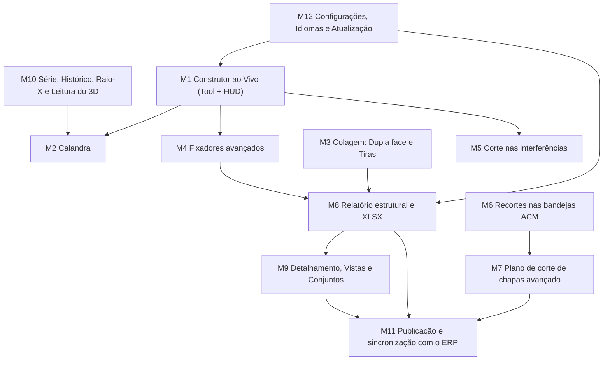

# Plano dos Módulos Restantes — `acm3d-cs`

> Continuação do [PLANO_PROJETO.md](../PLANO_PROJETO.md). A Fase 1 (MVP) entregou: catálogo de bitolas, gradil paramétrico, tubo avulso, bandeja ACM, malha de fachada, Ler ACM → Estrutura, planificação, DXF e envio ao ERP.
> Este documento planeja **os 12 módulos que faltam** para chegar ao escopo da referência ACM360 v1.1.92.

## Como ler este plano

Cada módulo traz:
- **Referência observada**: o que foi encontrado no pacote `ACM360_v1.1.92.rbz` (nomes de arquivos, chaves dos dicionários `pt.json` e telas HTML/JS abertas).
- **O que vamos construir**: as decisões de projeto do `acm3d-cs`.
- **Plugin / Web**: o que fica em cada lado.
- **Critérios de aceite**: como saber que o módulo está pronto.

> [!IMPORTANT]
> Os arquivos `.rbe` da referência são **criptografados** (cabeçalho `RBS2.0`). O código Ruby original **não foi lido**. Todo o comportamento abaixo vem de textos de interface, mensagens de erro, telas HTML/JS em texto aberto e dos dumps de atributos dos blocos `A002`/`A003`. Fórmulas marcadas como *(proposta)* são nossas, não da referência.

---

## Visão geral e dependências

| Fase | Módulos | Objetivo da fase |
| :--- | :--- | :--- |
| **Fase 2 — Base de produção** | M12, M8, M7, M11 | Números confiáveis para comprar material e mandar para o chão de fábrica. |
| **Fase 3 — Montagem e fixação** | M3, M4, M5, M6 | Tudo que a serralheria e a colagem precisam para montar. |
| **Fase 4 — Projeto e documentação** | M9, M10 | Pranchas para imprimir e edição segura do modelo 3D. |
| **Fase 5 — Produtividade e formas especiais** | M1, M2 | Edição direta na viewport e estruturas curvas. |

> [!NOTE]
> A ordem prioriza o que gera valor para o ERP primeiro (compras e produção). O Construtor ao Vivo (M1) é o mais complexo e fica por último; até lá o painel `UI::HtmlDialog` da Fase 1 continua sendo a interface principal.

---

## M12 — Configurações, Idiomas e Atualização

**Referência observada**
- Abas de configuração: `Bitolas`, `Fitas`, `Geral`, `Relatório`, `Impressão`, `Conta` (`settings.tabs`), mais a seção `ACM` (chapa padrão, lâmina, núcleo PE/FR, fresa, fator de dobra, refile, bandeja nova, desenho do vinco real/simplificado).
- Idiomas `pt`, `en`, `es` (`lib/locales/*.json`, `language_menu.rbe`, `i18n.rbe`).
- Atualização do plugin (`plugin_updater.rbe`, chaves `update.*`) e licença por conta (`auth.*`, `account_locale.rbe`).

**O que vamos construir**
- Configurações salvas com `Sketchup.write_default('CS_ACM360', ...)` (por máquina) e cópia no modelo (`attribute_dictionary`) para que o projeto abra igual em outro computador.
- Cadastro de bitolas editável (adicionar perfil próprio, cor, espessura, preço por metro).
- Cadastro de fitas dupla face (largura, comprimento do rolo, preço) — usado em M3.
- Padrões de ACM: chapa (5000×1220, 6000×1500…), espessura, fresa, fator de dobra.
- Cabeçalho de impressão (nome da empresa, telefone, e-mail, logo ≤ 300 KB).
- Idioma: começar só em **pt-BR**, com todos os textos em um arquivo `locales/pt.json` para permitir `en`/`es` depois.
- **Sem licença/login** nesta etapa: é ferramenta interna da CS. A conta do ERP entra só em M11.
- Atualização: botão "Verificar atualização" que consulta a última *release* do GitHub `acm3d-cs`.

**Plugin / Web**
- Plugin: diálogo de configurações e leitura/gravação dos padrões.
- Web: mesma tela na aba ACM360 Studio, salva em `localStorage`; exporta/importa JSON de configurações.

**Status (27/10/2026): entregue**
- Plugin: `lib/settings.rb` (fábrica < máquina < modelo) e aba **5. Configurações**. Barra, serra, chapa, espaçamentos, fita e fator de dobra deixaram de ser fixos no código.
- Fator de dobra cadastrado por fornecedor/espessura (padrões "Genérico 3 mm" = 1,5 e "Genérico 4 mm" = 2,0, a calibrar). Cada bandeja grava o fator usado na criação.
- Ao mudar a barra ou a serra, as estruturas paramétricas do modelo são regeradas.
- Web: `acm360-settings.js` + aba **4. Configurações**, com testes em `tests/acm360-settings.test.js`.
- **Adiado**: arquivo de idiomas (uso só em pt-BR, interno) e "Verificar atualização" (o repositório ainda não tem *releases* e deve ficar privado).

**Critérios de aceite**
- Mudar a barra de 6000 para 6500 mm altera plano de barras, emendas e relatório sem reabrir o SketchUp.
- Uma bitola criada pelo usuário aparece nos seletores do plugin e da web.
- Abrir o `.skp` em outra máquina mantém os padrões do projeto.

---

## M8 — Relatório estrutural, Lista de corte e XLSX

**Referência observada**
- Telas abertas `js/report-ui/report.html`, `cutlist.js`, `cutplan.js`, `report-app.js`.
- Filtros: `Todas`, `Estruturas`, `Fixadores`, `ACM` (tiras e fita dupla face ficam fora dos totais de metro).
- Escopo: `Selecionadas` / `Todas`.
- Colunas configuráveis: `metal`, `cor`, `desc`, `corte`, `comp`, `qty`, `total`; formato da descrição (`30 x 20`, `30x20`, `30-20`, `30/20`) e da espessura (`- 1.2mm`, `(1,2 mm)`, `esp. 1,2 mm`).
- Plano de barras: **FFD** e **melhor preenchimento** (subset-sum em décimos de mm, peso arredondado para cima), perda extra da serra `kerf × (1/cos θ − 1)` limitada a 75°.
- Exportação XLSX (`xlsx_generator.rbe`) e impressão com cabeçalho.

**O que vamos construir**
- Consolidar peças iguais (mesmo perfil, comprimento, cortes e cor) em uma linha com quantidade.
- Coluna de corte no padrão "A/B": ângulo de serra de cada ponta (0° = reto), corte composto como `45°/10°`, sinal negativo para espelhado.
- Plano de barras com os dois algoritmos e escolha automática do que usar menos barras.
- Peças maiores que a barra entram pelas emendas da Fase 1; aviso quando não há emenda possível.
- Exportar **XLSX** (lista + plano) e **CSV**; imprimir via janela HTML com `window.print()`.
- Totais por material: metros lineares, número de barras, peso estimado *(proposta: peso = perímetro × parede × densidade)* e custo, se o preço estiver cadastrado em M12.

**Plugin / Web**
- Plugin: janela de relatório lendo os dados salvos nos grupos (`tubes_json`).
- Web: mesma tela, reaproveitando o mesmo JavaScript (um único `report.js` usado nos dois lados, como faz a referência com `host-sketchup.js` / `host-web.js`).

**Status (27/10/2026): entregue no BETA 1.2.2**
- `ui/acm360-report.js` é o único código de relatório, usado pelo plugin (aba 4) e pelo painel web; testes em `tests/acm360-report.test.js`.
- Lista de corte consolidada (perfil + comprimento + corte A/B), plano de barras com FFD, *best fit* e melhor preenchimento (subset-sum em mm) escolhendo o que usa menos barras, perda angular `kerf × (1/cos θ − 1)` limitada a 75°.
- Peça maior que a barra sem emenda gera aviso. Peso por bitola (aço 7,85 / alumínio 2,70 g/cm³) e custo das barras compradas quando o R$/m está cadastrado no M12.
- XLSX gerado sem biblioteca (zip + SpreadsheetML), CSV com `;` e vírgula decimal, impressão em HTML com cabeçalho da empresa (no plugin abre no navegador padrão).
- Corrigido: o relatório antigo lia atributos que os kernels não gravam (tubos sumiam e toda bandeja saía 1000×600); a fita VHB do plugin e a distribuição de cantoneiras liam as mesmas medidas erradas; relatório, ERP e DXF liam só o nível aberto para edição e agora percorrem o modelo inteiro.
- **Adiado**: escopo "Selecionadas", filtros por tipo e colunas/formatos configuráveis.
- Validado no SketchUp 2025 com `tools/run_sketchup_tests.ps1` (19 verificações, incluindo os botões do painel) e XLSX aberto no Excel. LibreOffice ainda não testado.
- Corrigido junto: tubo avulso com corte inclinado não era desenhado (erro ao criar) e o DXF gravava só a primeira chapa do plano de corte; agora sai um arquivo por chapa (`_chapa1.dxf`, `_chapa2.dxf`…), e com uma chapa só o arquivo continua igual.

**Critérios de aceite**
- Para um caso de teste conhecido, o número de barras bate com o cálculo manual.
- Peças com ponta reta não ganham perda de serra extra.
- XLSX abre no Excel e no LibreOffice com acentos corretos.

---

## M7 — Plano de corte de chapas avançado (Nesting 2D)

**Referência observada**
- `nesting_bundle.js` (texto aberto, gerado a partir de TypeScript): várias heurísticas de encaixe (`bssf`, `baf`, `blp`, `cp`), contorno real das peças (não só retângulo), rotação 0/90/180/270, canto inicial (TL/TR/BL/BR), espaçamento e margem, orçamento de tempo (3 s retangular / 6 s irregular), semente fixa para resultado repetível, verificação final de colisão.
- Planos salvos no projeto (`nest.plans`): salvar, salvar como, renomear, excluir, **comparar planos** (chapas, aproveitamento, chapa mais vazia, maior retalho livre, peças fora).
- Arrastar peças entre chapas, "+ Nova chapa", travar orientação de peças com mesmo código.
- DXF por chapa com blocos `BLK_ACM_*` e camadas `ACM_CHAPA`, `ACM_CORTE`, `ACM_VINCO`, `ACM_DIRECAO`, `ACM_ETIQUETAS`.

**O que vamos construir**
- Trocar o encaixe por fileiras da Fase 1 por um motor **MaxRects** (retangular) + teste de contorno para peças irregulares.
- Respeitar o **sentido do ACM** (seta de direção): opção de proibir rotação de 90° em ACM escovado/madeirado.
- Usar **retalhos do estoque** do Totem ERP (aba Chapas) antes de abrir chapa inteira — integração direta com o que o ERP já faz ("sobras primeiro, inteiras por último").
- Editor manual: arrastar, girar, mandar para outra chapa, com checagem de colisão.
- Planos nomeados salvos no modelo e no ERP; tela de comparação.
- DXF **um arquivo por chapa** ou um arquivo com todas as chapas lado a lado.
- Registrar como retalho o que sobrar acima de um tamanho mínimo (configurável).

**Plugin / Web**
- O motor roda em **JavaScript** e é o mesmo nos dois lados (o plugin abre em `HtmlDialog`). Ruby só coleta as peças planificadas e salva o resultado.

**Critérios de aceite**
- Nenhuma sobreposição entre peças (teste automático com casos aleatórios).
- Mesmo conjunto de peças + mesma configuração = mesmo plano.
- Peça que usa retalho do estoque baixa aquele retalho no ERP ao gerar a OS.

---

## M11 — Publicação e sincronização com o ERP

**Referência observada**
- Tipos publicados (`publish.kinds`): `Estrutura`, `Lista`, `Barras`, `Chapas`, `Planificação`.
- Estado de cada item: `Novo`, `Alterado desde a Rev. N`, `Publicado na Rev. N`, `Removido do modelo`.
- Revisões com mensagem, fila de envio offline com nova tentativa, conflito quando outro arquivo já está ligado ao mesmo projeto, vínculo arquivo ↔ projeto.

**O que vamos construir**
- Formato de troca versionado `CS_ACM360_ERP_V1` (já existe) evoluindo para `V2` com: id estável por item, assinatura (hash) para detectar alteração, número da revisão.
- **Etapa A (sem servidor)**: exportar/importar `.json` — já funciona; acrescentar lista de diferenças entre revisões na tela do ERP.
- **Etapa B (com servidor)**: API do ERP (`POST /projetos/{id}/revisoes`) quando o backend do CS Fachadas existir. Fila local no plugin para quando estiver sem internet.
- Ao publicar: a OS recebe barras por perfil, chapas por tipo, lista de fixadores e de fita, e os DXFs anexados.
- Vínculo do `.skp` com a OS (atributo no modelo) para não duplicar OS a cada envio.

**Plugin / Web**
- Plugin: tela "Publicar" com os itens e estados, campo de mensagem.
- Web: importação, histórico de revisões e comparação.

**Critérios de aceite**
- Publicar duas vezes sem mudar nada não cria revisão nova.
- Alterar uma bandeja marca só ela (e suas chapas) como "Alterado".
- Sem internet, o envio fica na fila e sai sozinho quando a conexão volta (Etapa B).

---

## M3 — Colagem: Dupla face e Tiras de ACM

**Referência observada**
- **Dupla face**: lado (`frente`, `trás`, `esquerda`, `direita`, `topo`, `base`), onde aplicar (`Marco inteiro`, `Marco e travessas`, `Marco e travessas intercaladas`, `Marco de cima e de baixo`, `Marco das laterais`, `Só travessas`), fileiras (`auto`, 1, 2), espaço entre fileiras, recuo nas pontas; resumo em **fitas, rolos e metros**. Aviso quando a fita é mais larga que a face do tubo.
- **Tiras**: tira de junta e tira de preenchimento para junta rebaixada; descrição `código · tipo largura × comprimento mm · ACM esp mm · cor`; "tiras só em estrutura criada com Ler ACM"; se a frente tem tiras, a fita vai sobre elas.

**O que vamos construir**
- Fita desenhada como faixa fina sobre a face escolhida dos tubos (grupo separado, camada `CS_ACM360_Colagem`).
- Cálculo *(proposta)*: metros = Σ (comprimento útil do tubo − 2 × recuo) × fileiras; rolos = ⌈metros ÷ comprimento do rolo⌉.
- Tiras geradas a partir das juntas detectadas no Ler ACM: comprimento = comprimento da junta, largura = junta + 2 × sobra de colagem.
- Tiras vão para a fila de planificação como peças de ACM (entram no M7).
- Fita e tiras saem no relatório (M8) no filtro `ACM`, fora do total de metros de tubo.

**Critérios de aceite**
- Trocar o padrão de "Marco inteiro" para "Só travessas" atualiza desenho e resumo.
- Tiras aparecem no plano de chapas com a cor da bandeja.

---

## M4 — Fixadores avançados

**Referência observada**
- Tipos: `Ancoragem`, `Espera`, `Cantoneira Fixador` (blocos `F001`, `F002`, `F003`).
- Distribuição: `No clique`, `Por quantidade`, `Por distância`, `Perímetro (N por lado)`, `4 cantos`, `2 na diagonal` (dois sentidos), furação `Fixo (2 furos)` / `Oblongo (1 furo)`, posição `Início`, `Centro`, `Fim`, `Personalizado`.
- Parâmetros: parafuso de parede e de tubo (tipo e tamanho), bucha, afastamento, aba para dentro/fora, margem das pontas.

**O que vamos construir**
- Ferramenta de clique no tubo para colocar um fixador (depende do M1 para a parte interativa; antes disso, distribuição pelo painel).
- Distribuição automática ao longo do tubo ou do perímetro da estrutura.
- Cada fixador carrega sua lista de consumo: 1 peça + N parafusos + N buchas → vai para o relatório e para o ERP.
- **Blocos 3D próprios** da CS (ver Riscos) com componentes dinâmicos simples.

**Critérios de aceite**
- "Perímetro, 3 por lado" em um quadro gera 12 fixadores (ou 8 + cantos, conforme opção) nas posições certas.
- O relatório soma parafusos e buchas por tamanho.

---

## M5 — Corte nas interferências e ajuste de pontas

**Referência observada**
- "Cortar nas interferências": apara as pontas que entram em outro tubo; pula pontas que pediriam corte composto ou ângulo acima de 75°; mensagem com número de pontas e perfis.
- Painel do tubo com ângulo da ponta A/B, face do corte (largura/profundidade) e ponta longa (esquerda/direita/frente/trás).

**O que vamos construir**
- Para cada ponta selecionada: achar o plano da face do tubo vizinho que ela atravessa, recalcular comprimento e ângulo da ponta, regerar o tubo.
- Suporte a corte em um plano (simples). Corte composto fica para depois, com aviso.
- Atualiza comprimento de serra e perda angular no relatório.

**Critérios de aceite**
- Dois tubos cruzando em "L" a 90° viram encaixe reto; a 60° viram cortes de 30° nas pontas.
- Nenhuma ponta passa de 75°.

---

## M6 — Recortes nas bandejas ACM

**Referência observada**
- Itens de menu "Recortes nas bandejas ACM" e painel "Parâmetros do corte" (folga por lado, "N recortes em M bandejas", "vale só para as bandejas selecionadas") — arquivos `acm_clash.rbe`, `cutter_block.rbe`.

**O que vamos construir**
- Detectar onde tubos, fixadores ou objetos marcados como "furo" atravessam a bandeja.
- Abrir o recorte na face da bandeja com folga configurável e levar o contorno para a planificação (linhas na camada `ACM_CORTE`).
- Recortes de forma livre (círculo, retângulo, contorno de letra caixa para iluminação).

**Critérios de aceite**
- Um furo de 100 mm na face aparece no DXF na posição certa, com a folga aplicada.
- Recorte perto da dobra gera aviso.

---

## M9 — Detalhamento, Vistas, Etiquetas e Conjuntos

**Referência observada**
- Prancha `js/detail-sheet/` (texto aberto): papel A4/A3, retrato/paisagem, vistas `Frente`, `Trás`, `Direita`, `Esquerda`, `Acima`, `Abaixo`, `Iso`, escala 1:N.
- Cotas: `Só as medidas totais`, `Totais e vãos entre tubos`, `Totais, vãos e cada peça`, `Por dobra`, `Híbrida`; referência `Centro`, `Início`, `Vão livre`, `Acumulada`; terminação traço/seta/ponto; balões; ângulos `não`/`diferentes`/`todos`; exportar PDF (`sheet-pdf.js`).
- "Etiqueta e vistas do objeto selecionado": cria cenas por direção e etiqueta.
- **Conjuntos**: agrupar peças com nome, detalhar conjunto, desfazer.
- Cena de bandejas planificadas com códigos `P01…` (`flat_scene.rbe`).

**O que vamos construir**
- Gerador de vistas 2D a partir dos dados salvos (não de imagem da tela): cada tubo e bandeja vira retângulo/polígono em SVG, o que garante cota exata.
- Cotas automáticas nos modos acima; balões ligando à lista de peças.
- Prancha com carimbo CS Comunicação (cliente, OS, data, revisão, escala), exportada em PDF pelo navegador.
- Cenas do SketchUp por direção para quem quiser usar o LayOut.
- Conjuntos: atributo de agrupamento usado no relatório e na prancha.

**Critérios de aceite**
- A cota de largura na prancha é igual ao parâmetro da estrutura.
- PDF A3 paisagem imprime em escala 1:20 conferida com régua.

---

## M10 — Série, Histórico, Raio-X e Leitura do 3D

**Referência observada**
- **Série**: vincular cópias iguais ("alterar uma muda todas"), separar, selecionar; bloqueia quando há escala, parâmetro ou seção diferente.
- **Histórico**: registros com antes/depois por campo e "Reverter para hh:mm".
- **Raio-X**: transparência do ACM para ver a estrutura.
- **Leitura do 3D** (`frame_sync`, `frame_reconcile`, `frame_scale`): quando o usuário move, estica, gira ou apaga um tubo com as ferramentas nativas, o plugin lê a mudança, avisa e permite "Reintegrar" ou "Restaurar parâmetros" (com backup do arquivo antes).

**O que vamos construir**
- `Sketchup::EntityObserver` / `ModelObserver` nos grupos do plugin para detectar edição nativa.
- Regras simples primeiro: escala do grupo → recalcula largura/altura; tubo esticado no próprio eixo → ajusta só aquele tubo; tubo girado → vira "tubo livre" fora da malha.
- Histórico guardado no próprio grupo (últimos 30 registros, JSON).
- Série via definição de componente compartilhada + id de série.
- Raio-X: troca temporária de material para transparente, sem alterar o modelo salvo.

**Critérios de aceite**
- Escalar o grupo da estrutura em 10% na largura atualiza a lista de corte.
- Reverter o histórico devolve exatamente os parâmetros anteriores.
- Ctrl+Z desfaz cada operação do plugin em um passo só.

---

## M1 — Construtor ao Vivo (ferramenta na viewport + menu radial)

**Referência observada**
- `live_tool.rbe` (o maior arquivo, 430 KB), `live_hud.rbe`, `live_panel.rbe`, `live_html_panel.rbe`.
- Menu radial com 19 ações (`hud.hub`): calandra, bandeja, estrutura, tubo, gradil, ler ACM, fixador, ler, recortes, planificar, plano de corte, colagem, projeto, vistas, detalhar, relatório, publicar.
- Edição por alças: arrastar borda, digitar medida (VCB), Tab troca tipo de borda, setas mudam retorno, Ctrl copia, inverter H/V/profundidade, girar em 3 pontos, trena de guias.

**O que vamos construir**
- `Sketchup::Tool` com estados: escolher ação → posicionar → arrastar → digitar medida.
- Desenho temporário com `view.draw` (preview antes de criar geometria).
- Alças nas bordas da estrutura e da bandeja para esticar com inferência do SketchUp.
- Campo de medida (VCB) aceitando `1200;600` (largura;altura).
- Menu radial desenhado com `view.draw2d`.
- Painel lateral HTML que mostra os parâmetros da peça sob o mouse.

**Critérios de aceite**
- Criar um gradil em 3 cliques + 1 medida digitada.
- Esticar a borda direita com o mouse atualiza a estrutura e a lista de corte.
- Esc cancela sem deixar geometria solta.

---

## M2 — Calandra (estruturas e bandejas curvas)

**Referência observada**
- Tipos: **Curvar a frente** ("pontas e laterais ficam; só a frente abaúla") e **Dobrar** ("o comprimento fica; a ponta gira" — pórtico, anel).
- Modos: `Toda curvada` / `Fundo reto na parede` (máximo 75° nesse modo).
- Medidas: início, fim, trecho, raio, flecha, ângulo, corda, desenvolvimento; ímã de 1/5/10 mm ou 1°/5°/15°.
- Montantes `radiais` ou `paralelos`; canto `passante` ou `encosto`; peça `inteira` (só o trecho curva, ponta reta na mesma barra) ou `emendada`.
- Erros: raio pequeno para a profundidade, mais de uma volta, arco não alcança as pontas; diagonal curvada não se fabrica.

**O que vamos construir**
- Relações geométricas do arco (padrão, não da referência): com corda $c$ e flecha $f$,
  $$R = \frac{c^2}{8f} + \frac{f}{2}, \qquad \theta = 2\arcsin\!\left(\frac{c}{2R}\right), \qquad L_{\text{desenv}} = R\,\theta$$
- Tubo curvo desenhado em segmentos; na lista de corte sai o **desenvolvimento** e uma ficha de calandra (raio, flecha, corda) para a serralheria.
- Bandeja ACM curva: planificação pelo desenvolvimento; vincos só nas dobras retas.
- Validação: raio mínimo *(proposta)* = 3 × altura do perfil no plano da curva, configurável.

**Critérios de aceite**
- Arco com corda 2000 mm e flecha 200 mm gera R = 2600 mm e desenvolvimento ≈ 2107 mm.
- Ficha da calandra impressa junto com a prancha (M9).

---

## Lado Web: o que muda no Totem ERP

| Módulo | Mudança no ERP |
| :--- | :--- |
| M7 | Aba **Chapas** passa a sugerir o retalho certo para cada peça da OS e mostra o plano de corte da OS. |
| M8 | **Material** recebe a lista consolidada (barras por perfil, parafusos, buchas, fita) como "previsto na OS". |
| M11 | Detalhe da OS mostra revisão do projeto, diferenças e DXFs anexados. |
| M9 | Detalhe da OS abre a prancha PDF no lugar do croqui desenhado à mão. |
| M3/M4 | Etapa **Montagem** recebe checklist de fixadores e fita. |

---

## Testes e qualidade

- **Ruby**: testes dos cálculos puros (emendas, FFD, planificação, arco) com `minitest`, rodando fora do SketchUp.
- **JavaScript**: testes do nesting e do plano de barras com Node (`node --test`), incluindo casos aleatórios verificando "nenhuma sobreposição".
- **Casos de referência**: 5 projetos reais da CS (fachada simples, fachada com letra caixa, totem, testeira curva, painel com recortes) com resultado conferido à mão; rodar a cada mudança.
- **SketchUp**: checklist manual no SketchUp 2025 (versão usada pela CS).

---

## Riscos e pendências

> [!WARNING]
> **Propriedade intelectual.** O repositório `acm3d-cs` foi criado como **público** e contém os três blocos `.skp` copiados da pasta `BLOCOS` do ACM360 (`Ancoragem_F001`, `Espera_F002`, `Cantoneira_Fixador_F003`). Esses arquivos são de terceiros. Recomendação: **tornar o repositório privado** e **substituir os blocos** por modelos desenhados pela CS antes de distribuir o plugin. O código do `acm3d-cs` foi escrito do zero (os `.rbe` são criptografados e não foram lidos), mas nomes de camadas e fluxos seguem a referência.

| Risco | Impacto | Mitigação |
| :--- | :--- | :--- |
| Versões antigas do SketchUp com navegador embutido (CEF) antigo | Telas quebram | JavaScript sem recursos muito novos nas janelas do plugin; testar em 2021. |
| Modelos grandes (centenas de bandejas) | Lentidão | Cálculo em JS com limite de tempo; geometria desenhada só no fim da operação. |
| Edição nativa do usuário quebra parâmetros | Lista de corte errada | M10 detecta e avisa; relatório marca peças "a conferir". |
| Backend do ERP ainda não existe | M11 Etapa B bloqueada | Etapa A (JSON) cobre o fluxo até lá. |
| Fator de dobra varia por fornecedor de ACM e fresa | Peça sai com medida errada | Cadastro por chapa/fresa em M12 e peça de teste para calibrar. |

### Perguntas para a CS (respondidas em 27/10/2026)
1. **Versão do SketchUp**: 2025. Testes e checklist passam a mirar o SketchUp 2025.
2. **ACM**: espessuras de 3 mm e 4 mm, de diversos fornecedores. M12 deve ter cadastro de fator de dobra por fornecedor/espessura.
3. **CNC**: os DXFs são importados no **Vectric Aspire**, que gera o G-code (`.txt`) levado à Router por pendrive; um aplicativo próprio roda o G-code na máquina e ainda precisa de ajustes. **Testado**: o DXF R12 exportado pelo plugin importa corretamente no Aspire — manter o formato atual.
4. **Distribuição**: uso **interno**. Sem licença/login; ainda assim, manter o repositório privado por causa dos blocos de terceiros.
5. **Backend do ERP**: sem previsão. M11 fica na **Etapa A** (troca por `.json`); Etapa B adiada.
